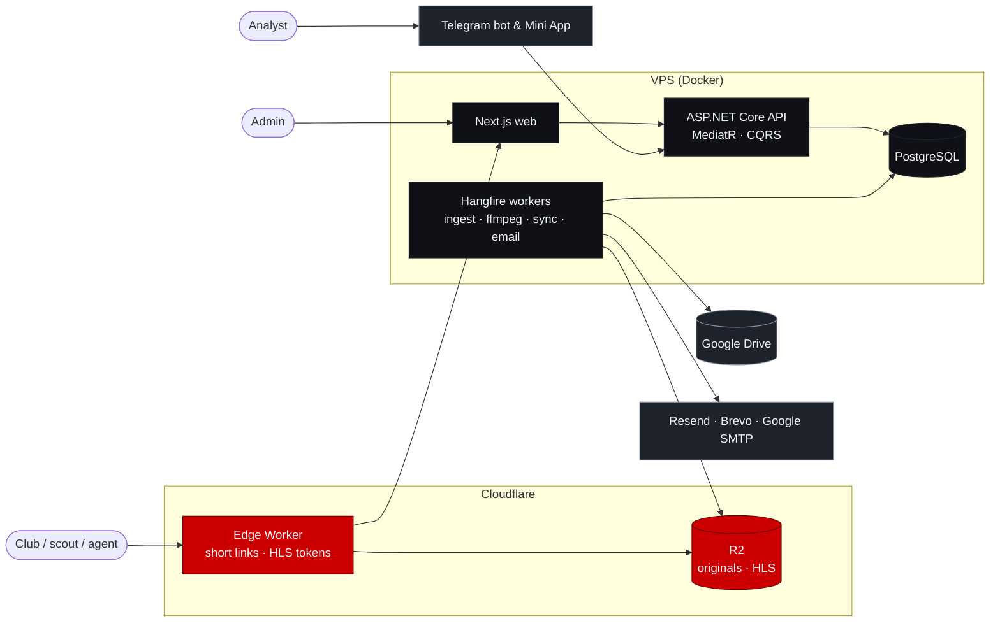

<div align="center">

# SS-SPORT Drive

**Fetch Your Dreams.**

Branded, trackable volleyball player video pages, built straight from Google Drive.

[](https://github.com/Mohammadreza0083/SS-SPORT-Drive/actions/workflows/ci.yml)


[What it does](#what-it-does) ·
[Architecture](#architecture) ·
[Tech stack](#tech-stack) ·
[Quick start](#quick-start) ·
[Project structure](#project-structure) ·
[Engineering rules](#engineering-rules) ·
[Roadmap](#roadmap)

</div>

---

## What it does

SS-SPORT analysts drop a player's footage into a Google Drive folder named `SS-SPORT <Full Name>`. SS-SPORT Drive turns it into a polished, brand-styled player page and tracks who watches it.

| | |
|---|---|
| 🎬 **Ingest** | Reads Drive folders and subfolders, copies originals to Cloudflare R2, transcodes to HLS (360p / 720p / 1080p) with the burned-in SS-SPORT watermark. |
| 🔗 **Personal links** | Every club, scout or agent gets their own `/r/{code}` link, gated by email OTP, with device binding and forwarding alerts. |
| 🛡️ **Protection** | HLS segments only, 30-minute HMAC-signed tokens refreshed while watching, a moving viewer-email overlay. No downloads, ever. |
| 📊 **Tracking** | Plays, minutes watched, completion, replay hotspots and last-seen time per viewer, per player and per video. |
| 🔎 **Public search** | Anyone can search players. Media stays blurred and locked until an admin approves an access request. |
| 🤖 **Telegram** | Analysts add players from a Telegram Mini App; admins get approvals, alerts and a daily digest from the bot. |
| 🧭 **Admin console** | Dashboard, waiting list, players, links, viewers, access requests, sync jobs and the email queue. |

## Architecture



The backend follows **Clean Architecture** with **CQRS + DDD**. Dependencies point inwards only, and architecture tests enforce it:

```
Api / Workers  →  Infrastructure  →  Application  →  Domain
```

## Tech stack

| Area | Technology |
|---|---|
| Backend | .NET 10, ASP.NET Core, MediatR, Mapperly, FluentValidation, EF Core |
| Data | PostgreSQL, Unit of Work + generic repository, Specification pattern, `AsNoTracking` read projections, server-side paging (offset + keyset cursors) |
| Jobs | Hangfire (PostgreSQL storage), ffmpeg |
| Front-end | Next.js 16, TypeScript, Media Chrome + hls-video-element |
| Edge & storage | Cloudflare Workers, Cloudflare R2, Turnstile |
| API docs | OpenAPI + Scalar at `/scalar` |
| Observability | Serilog → Grafana Loki → Grafana |
| Testing | xUnit v3, FluentAssertions, NSubstitute, NetArchTest, Testcontainers, Vitest, Playwright, k6 |
| Delivery | Docker, GitHub Actions |

## Quick start

**Prerequisites:** [.NET SDK 10](https://dotnet.microsoft.com/download) · [Node.js 24](https://nodejs.org) · [Docker](https://www.docker.com/products/docker-desktop/) (integration tests start PostgreSQL with Testcontainers)

```bash
# Backend: build and run every test (unit, architecture, integration)
dotnet build SsSport.Drive.slnx
dotnet test --solution SsSport.Drive.slnx

# Web
cd web && npm ci && npm run dev        # http://localhost:3000

# Edge worker
cd edge && npm ci && npm test
```

### Configuration (.env)

All settings live in one git-ignored `.env` at the repository root. Docker Compose, the API and workers ([DotNetEnv](https://github.com/tonerdo/dotnet-env)) and the web app (`web/next.config.ts`) all read it. `.env.example` lists every key.

```bash
cp .env.example .env   # then fill in the secrets
```

### Whole stack in Docker

Runs PostgreSQL, RustFS (S3-compatible stand-in for R2), a one-shot `migrate` job, the API, the workers and the web app. Only Docker is needed.

```bash
docker compose up -d --build --wait
```

| Service | URL |
|---|---|
| Web | http://localhost:3000 |
| API liveness / readiness (DB) | http://localhost:5080/health/live · http://localhost:5080/health/ready |
| API docs (Scalar, not in production) | http://localhost:5080/scalar |
| Storage console | http://localhost:9001/rustfs/console/ |
| PostgreSQL | `localhost:5432` |

The `migrate` service applies the EF Core migrations and exits. The API starts only after it succeeds, and no app migrates on start-up.

Every port is bound to `127.0.0.1` only. The API answers browsers only from the origins in `Cors__AllowedOrigins`.
Stop with `docker compose down` (add `--volumes` to wipe the data).

### Database migrations

The schema is managed with EF Core migrations in `src/SsSport.Drive.Infrastructure/Persistence/Migrations` (snake_case names, PostgreSQL). `dotnet-ef` is a local tool.

```bash
dotnet tool restore
dotnet ef migrations add <Name> --project src/SsSport.Drive.Infrastructure --output-dir Persistence/Migrations
```

To chat with the bot on your machine, set `Telegram__Mode=Polling` (plus `Telegram__Proxy` where Telegram needs a VPN). The API then fetches updates itself, so no public URL is needed.

After a deploy, `dotnet SsSport.Drive.Api.dll telegram-set-webhook` registers the bot's webhook (`Telegram__WebhookUrl`, `Telegram__WebhookSecret`) and, when `Telegram__MiniAppUrl` is set, the "Open Drive" menu button. Where Telegram needs a VPN, set `Telegram__Proxy`.

The Telegram Mini App lives at `/miniapp` in the web app. It signs in on every request with Telegram's signed `initData` (`Authorization: tma <initData>`, valid for 24 hours); only active analysts and admins get through. Telegram opens Mini Apps over HTTPS only, so trying it from the bot needs a public HTTPS URL.

Analysts add a player at `/miniapp/new`: category, name, nationality, positions, Volleybox link and Drive folder link, both checked live. The folder is read with the service account (`GoogleDrive__*`), must be in the agency's Shared Drive, and is previewed with its name and file counts; where Google needs a VPN, set `GoogleDrive__Proxy`. The player waits on the admin waiting list until an admin publishes it. The browser only calls same-origin `/api/miniapp/*` routes, which forward to `API_BASE_URL`. Right after, the analyst adds the photo (JPEG, PNG, WebP or HEIC, at least 800 px on its shorter side); the API makes it upright, strips its metadata and stores it as WebP in the `Storage__*` bucket next to the original.
Each player's analyst gets one progress message from the bot, edited in place as the player changes (links, folders, photo, waiting for an admin). The photo can also be sent straight in the bot chat: reply to the player's progress message with it (or pick the player from the bot's buttons); send it as a File to keep full quality. When the Volleybox link already has a player, the form switches to update mode: the player card with **Add this folder** (any team member; the owning analyst is told by the bot), **Update photo & details** (the owning analyst while the player waits, an admin always) and **Just open the existing page**.

To apply migrations by hand, run `dotnet run --project src/SsSport.Drive.Api -- migrate` (reads `ConnectionStrings__DefaultConnection`). An integration test fails if the model changes without a migration.

## Project structure

```
SS-SPORT Drive/
├── src/
│   ├── SsSport.Drive.Domain/           # Entities, aggregates, value objects, domain events
│   ├── SsSport.Drive.Application/      # MediatR commands & queries, DTOs, specifications
│   ├── SsSport.Drive.Infrastructure/   # EF Core, Unit of Work, repositories, external services
│   ├── SsSport.Drive.Api/              # HTTP API host (OpenAPI + Scalar)
│   └── SsSport.Drive.Workers/          # Background job host (Hangfire)
├── tests/                              # Unit, architecture & integration tests
├── web/                                # Next.js front-end
│   ├── src/app/(viewer)/               # Viewer site shell (dark brand layout, intro script)
│   ├── src/components/viewer/          # Shared viewer components (nav, footer, name reveal, ticker…)
│   └── src/styles/                     # Brand tokens, motion system, shell styles
├── edge/                               # Cloudflare Worker
├── deploy/                             # Staging/production deployment & operations
├── perf/k6/                            # k6 benchmarks (smoke + load profiles), see perf/k6/README.md
├── docker-compose.yml                  # Local stack (reads the root .env)
├── .env.example                        # Every setting; copy to .env
└── .github/workflows/                  # CI pipeline
```

## Engineering rules

- 🌿 **One branch per feature:** `feature/<area>-<short-name>`, merged into `main` by pull request with green CI.
- 🛡️ **Protected `main`** (ruleset, active once the repo is on GitHub Pro):
  - no deletion and no force-push;
  - changes only through a pull request, with conversations resolved;
  - required checks: `.NET build, format & tests`, `Web lint, typecheck, tests & build`, `Edge typecheck & tests` and `Local Docker stack smoke test`, with the branch up to date.
- 🧪 **Tests first:** every handler, endpoint and domain rule starts as a failing test. Nothing is committed red.
- 🧱 **Architecture:** MediatR for every command and query, Specification pattern for query criteria, DTOs at every API boundary.
- 📄 **Paging:** no list is ever sent whole. Lists use `IPagedQuery` / `ICursorQuery` and `IPagedReader`, which page in SQL (20 per page by default, 100 at most). An architecture test fails any query that returns a bare collection unless it is marked `[UnpagedList("reason")]`.
- 📝 **Docs in code:** XML docs on every .NET member (the build fails without them), TSDoc on exported TypeScript.
- 📚 **API docs:** every endpoint is fully described in OpenAPI and rendered with Scalar.
- 🔒 **No secrets in git:** configuration comes from environment variables and secrets only.
- 🌐 **English** in code, comments, logs and commits.
- 📦 **NuGet versions** live only in `Directory.Packages.props`; `nuget.config` pins packages and the vulnerability audit to nuget.org, so builds stay warning-free.

## Roadmap

| # | Epic | Status |
|---|---|---|
| 0 | Setup & accounts | 🚧 In progress |
| 1 | Core domain & persistence | ✅ Done |
| 2 | Telegram bot & Mini App | 🚧 In progress |
| 3 | Ingest, transcode & sync | ⏳ Planned |
| 4 | Viewer site & media protection | 🚧 In progress (V-1 shell, V-3 player done) |
| 5 | Personal links, OTP & tracking | ⏳ Planned |
| 6 | Public search & access requests | ⏳ Planned |
| 7 | Admin console | ⏳ Planned |
| 8 | Archive migration | ⏳ Planned |
| 9 | Deploy & operations | ⏳ Planned |
| 10 | Performance (k6) | ⏳ Planned |

Work is tracked in Jira (project **SSD**).

---

<div align="center">

**Proprietary software.** Copyright © 2026 SS-SPORT. All rights reserved. See [LICENSE](LICENSE).

[info@ss-sport.co](mailto:info@ss-sport.co)

</div>
